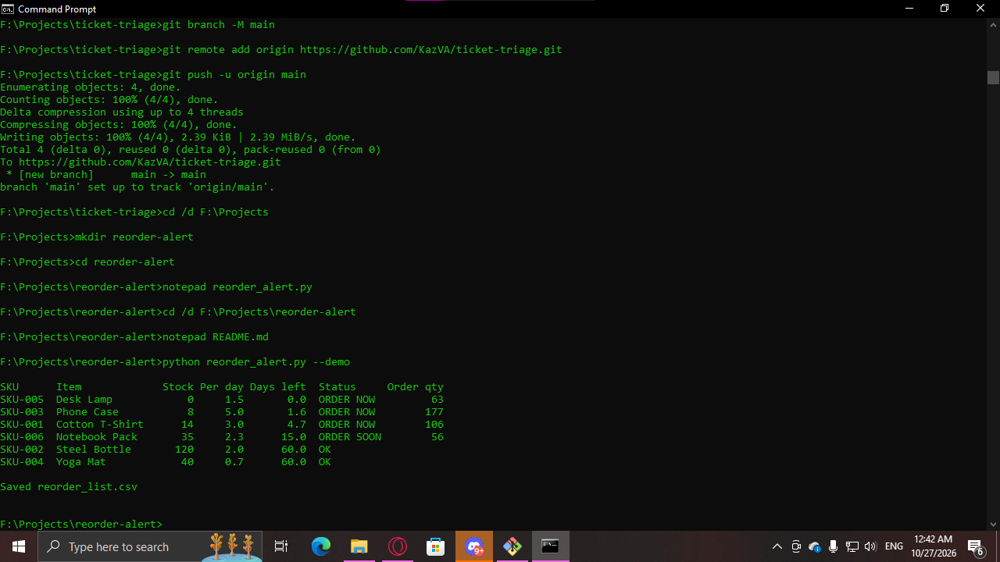

# Reorder Alert

Small businesses can lose sales or tie up cash when they fail to track inventory levels and reorder stock on time.

Reorder Alert is a lightweight Python tool for small-business owners, shop operators, and inventory managers who want to identify low-stock products and calculate suggested reorder quantities using CSV data.

## Features

- Analyzes inventory and sales data.
- Identifies products that need replenishment.
- Calculates suggested reorder quantities.
- Exports results to `reorder_list.csv`.
- Includes a demo mode for testing.
- Uses only the Python standard library.

## Requirements

- Python 3.8 or later

## Getting Started

Clone the repository or download its source code, then open a terminal in the project directory.

Run the demo:

```bash
python reorder_alert.py --demo
```

The tool generates sample inventory data, processes it, and creates `reorder_list.csv`.

## Example Output

Run the demo in your terminal to see the inventory report and generated reorder list.

**Terminal screenshot:** Run the command above and capture the terminal showing the results. Save the image as `screenshot.png` in the project directory, then display it here:



## Input and Output

- **Input:** Inventory and sales information provided through CSV data.
- **Output:** `reorder_list.csv`, containing reorder statuses and suggested quantities.

Inspect the sample CSV generated by demo mode to understand the expected input columns.

## Sample Data

All data generated by demo mode is mock data created for demonstration and testing. It does not represent real customers, businesses, or transactions.

## Limitations

- Results depend on the input data and the reorder rules implemented in the script.
- Products with zero recorded daily sales may be treated as having unlimited stock coverage.
- Review suggested quantities before making purchasing decisions.
- The tool does not connect to a live inventory system.

## Next Steps

- Add configurable safety-stock levels and reorder thresholds.
- Support inventory exports from accounting and business tools such as Tally or Zoho.
- Add automated low-stock email alerts.
- Build a web dashboard for inventory summaries and reorder tracking.
- Improve CSV validation and handling of missing or invalid values.

## License

MIT
